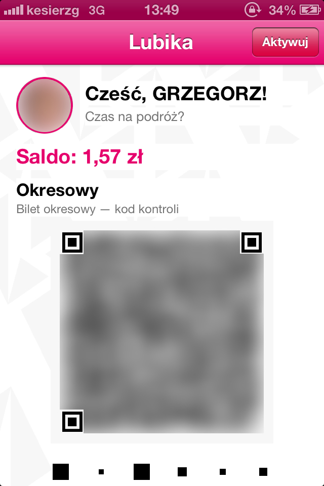

# Lubika Legacy (iOS 6)

THIS APP HAS BEEN CREATED WITH HELP OF AI. OBJECTIVE-C AIN'T EASY

UI still needs work to be 1:1, beta 1 is PoC.

<p align="center">
  
</p>

DISCLAIMER: 

> This is an client for an account you pay for. NOT a ticket piracy tool.

> It is not affiliated with ZTM Lublin and using it may be against their terms.

A Lubika client ported from official Android apk.

It logs into your Lubika account and displays the **server-rendered control QR**, your profile and balance.

It **does not** allow you to buy tickets!!! You need a periodic ticket to use this app!!!

It has been tested in real life and was successful. However it really is a lottery and your milage may vary,
depending on time, place, math, star positions, or if the ticket inspector is a chad or an asshole.

━━━━━━━━━━━━━━━━━━━━━━━━━━━━━━━━

UWAGA:

> To jest klient dla konta, za które płacisz. NIE jest to narzędzie do piractwa.

> Aplikacja nie jest autoryzowana przez ZTM Lublin i korzystanie z niej może być wbrew ich regulaminowi.

Klient Lubika przeportowany z oficjalnej aplikacji na Androida.
Loguje się na twoje konto Lubika i pokazuje **kod QR kontroli generowany po stronie serwera**, twój profil i saldo.
**Nie** da się w nim kupować biletów!!! Żeby z tego korzystać, musisz mieć bilet okresowy!!!

Przetestowane w realu, działa. Ale niczego nie obiecuję i u ciebie może być różnie, 
zależnie od czasu, miejsca, matematyki, układu gwiazd albo od tego, czy kontroler to chad, czy przegryw.

# Requirements

- jailbroken iOS 6 device
- updated root certificates (tlsroot.litten.ca)
- TLSFix tweak

━━━━━━━━━━━━━━━━━━━━━━━━━━━━━━━━

WYMAGANIA

- urządzenie z iOS 6 z jailbreakiem
- zaaktualizowane certyfikaty (tlsroot.litten.ca)
- dodatek TLSFix

## Build

Even though it targets iOS 6, the app builds with a **modern Xcode toolchain**
(tested on Xcode 27) from a single script.
`build.sh` works around everything the modern toolchain breaks on an iOS 6 /
armv7 target; the gory details are in the header comment of the script
(libarclite removal, the iOS-simulator `.tbd` mismatch, missing
`objc_msgSend_stret`, and the iOS 6 `LC_MAIN`-with-a-Thumb-`main` SIGILL).

Requirements on the build Mac:
- Xcode command-line tools (`clang`, `ld`)
- `ldid` for pseudo-signing — `brew install ldid`
- `dpkg` for the `.deb` — `brew install dpkg`
- an armv7 iOS SDK with device `.tbd` stubs at `~/theos/sdks/iPhoneOS10.3.sdk`
  (only the SDK is borrowed from theos; override with `RAW_SDK=/path/to.sdk`).
  On first run the script makes a patched, device-only copy under `sdk/`.

Then:
```
./build.sh
```
It compiles all of `LubikaLegacy/*.m` (armv7, ARM mode, min iOS 6.1),
pseudo-signs with `get-task-allow`, and writes every artifact into `build/`.

## Install 

/build.sh generates two formats: DEB and IPA.

DEB is preffered, IPA is seconadry and required AppSync Unifed. 
